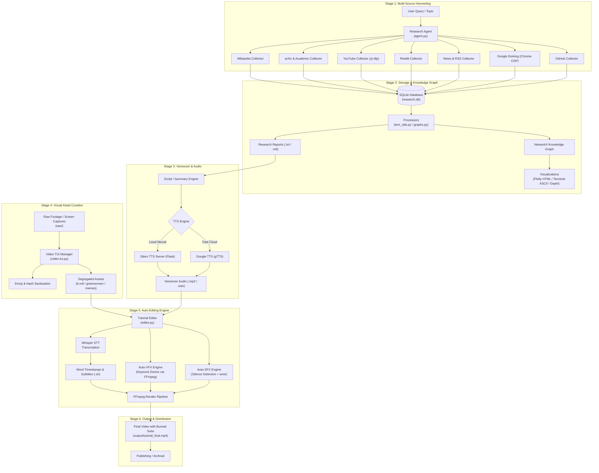

# 🎬 Content Machine

> **Autonomous Multi-Source Research, Knowledge Synthesis, Asset Curation, and Video Production Engine.**

[](https://www.python.org/)
[](https://docs.astral.sh/uv/)
[](https://github.com/openai/whisper)
[](https://ffmpeg.org/)
[](https://textual.textualize.io/)
[](https://networkx.org/)

---

## 📖 Table of Contents

- [Overview](#-overview)
- [System Architecture](#-system-architecture)
- [Core Features & Modules](#-core-features--modules)
  - [1. Research Agent & Multi-Source Collectors](#1-research-agent--multi-source-collectors)
  - [2. Knowledge Processing & Graph Visualization](#2-knowledge-processing--graph-visualization)
  - [3. Voiceover & Speech Synthesis (TTS)](#3-voiceover--speech-synthesis-tts)
  - [4. Asset Management TUI (`video-tui.py`)](#4-asset-management-tui-video-tuipy)
  - [5. Automated Video Editor (`editor.py`)](#5-automated-video-editor-editorpy)
  - [6. High-Level Pipeline Orchestration](#6-high-level-pipeline-orchestration)
- [Repository Structure](#-repository-structure)
- [Prerequisites & System Requirements](#-prerequisites--system-requirements)
- [Installation & Setup](#-installation--setup)
- [Quick Start Guide](#-quick-start-guide)
  - [A. One-Command Video Creation](#a-one-command-video-creation)
  - [B. Multi-Source Research Harvesting](#b-multi-source-research-harvesting)
  - [C. Knowledge Graph Exploration](#c-knowledge-graph-exploration)
  - [D. Asset Ingestion & Tagging TUI](#d-asset-ingestion--tagging-tui)
  - [E. Running the Fast Video Editor](#e-running-the-fast-video-editor)
  - [F. Local Silero Neural TTS Server](#f-local-silero-neural-tts-server)
- [Directory Conventions](#-directory-conventions)
- [Current Implementation State & Known Gaps](#-current-implementation-state--known-gaps)
- [Comprehensive TODO Task List & Roadmap](#-comprehensive-todo-task-list--roadmap)
- [Troubleshooting & FAQ](#-troubleshooting--faq)
- [License](#-license)

---

## 🌟 Overview

**Content Machine** is a developer-focused, automated content creation pipeline that converts raw ideas and queries into fully edited, captioned video productions. Instead of manually scouring the web, scripting, recording voiceovers, cutting footage, adding transitions, inserting sound effects, and burning subtitles, Content Machine links these phases into a cohesive automated workflow:

1. **Deep Parallel Research**: Harvests academic papers, Wikipedia articles, Reddit conversations, news feeds, YouTube transcripts, and advanced Google Dorks simultaneously.
2. **Knowledge Synthesis**: Extracts keywords, structures relations via NetworkX graphs, generates extractive summaries, and outputs reports.
3. **Voiceover Generation**: Supports fast Google TTS (`gTTS`) or high-fidelity local neural speech with `Silero TTS`.
4. **Asset Organization**: Features a terminal-based UI (`video-tui.py`) built with Textual to sanitize raw video filenames, preview footage via `mpv`, tag assets, and sort B-roll into categories.
5. **Intelligent Video Editing**: Powered by `ffmpeg` and `whisper`:
   - Aligns voiceover audio with screen recordings or B-roll footage.
   - Automatically generates word-accurate `.srt` subtitles and burns them into the video.
   - **Auto-VFX**: Detects key phrases (*"important"*, *"watch"*, *"click"*, *"note"*) and executes dynamic camera zoom-ins.
   - **Auto-SFX**: Scans for speech pauses and silences, automatically overlaying subtle audio cues (whooshes, clicks, pops) for higher viewer retention.

---

## 🏗️ System Architecture



---

## 🧩 Core Features & Modules

### 1. Research Agent & Multi-Source Collectors
Located in [`agents/research-agent/`](file:///home/theos/content-machine/agents/research-agent/):
- **Parallel Dispatch**: Queries multiple collectors concurrently via Python's `ThreadPoolExecutor`.
- **Global Deduplication**: Filters identical URLs across collectors on the fly.
- **Supported Collectors**:
  - `collectors/wikipedia.py`: Wikipedia API search, markdown table/heading cleanup, and citation stripping.
  - `collectors/arxiv.py` & `collectors/academic.py`: Queries arXiv, CrossRef, OpenAlex, Semantic Scholar, Internet Archive, and CORE.
  - `collectors/youtube.py`: Flat-playlist fast metadata extraction with `yt-dlp` and transcript fetching via `youtube-transcript-api`.
  - `collectors/reddit.py`: JSON scraping of target subreddits, posts, and discussion threads.
  - `collectors/news.py` & `collectors/web.py`: RSS feeds, BeautifulSoup4, and Trafilatura article extraction.
  - `collectors/google_dork.py`: Connects to Chrome DevTools Protocol (CDP) WebSocket to automate advanced search queries (`site:`, `filetype:pdf`, `intitle:`).
  - `collectors/github.py`: Searches public repositories, READMEs, and technical documentation.

### 2. Knowledge Processing & Graph Visualization
- **Database Layer (`database/db.py`)**: SQLite database with normalized schema for sources, collectors, publish dates, and keywords.
- **Processors (`processors/`)**:
  - `text_utils.py`: Extractive summarization with sentence scoring (length/position) and frequency-based keyword extraction.
  - `embeddings.py`: Sentence transformer embeddings via Hugging Face inference API (`all-MiniLM-L6-v2`).
  - `graphs.py`: NetworkX graph definitions.
- **Graph Visualizers**:
  - `visualize_interactive.py`: Generates standalone interactive 2D physics graphs using Plotly.
  - `terminal_graph.py`: Outputs ASCII frequency bars and connection graphs directly in your terminal.
  - `create_dashboard.py`: Creates Vis.js HTML dashboards with real-time keyword clustering.
  - `export_to_gephi.py`: Exports graph data to standard `.gexf` files for professional analysis in Gephi.

### 3. Voiceover & Speech Synthesis (TTS)
- **Local Neural Voice Server (`collectors/tts_server.py`)**:
  - Flask-based REST service powered by `silero_tts`.
  - Multiple English speakers (`en_0`, `en_1`, `en_2`, `en_3`) with 24kHz audio synthesis.
  - Zero external cloud latency or API cost.
- **Lightweight Alternative (`collectors/tts.py`)**:
  - Instant speech generation using Google Text-to-Speech (`gTTS`).

### 4. Asset Management TUI (`video-tui.py`)
A fast terminal UI built with [Textual](https://textual.textualize.io/) for organizing video files:
- **Footage Browser**: Scans `raw/` directory for `.mp4`, `.mkv`, `.webm`, `.avi`, and `.mov`.
- **Sanitizer**: Cleans filenames by removing emojis, hashtags (e.g., `#viral`), spaces, and invalid characters, converting them to clean snake_case.
- **Quick Player**: Plays selected clips directly via `mpv` (or `termux-open` in mobile environments).
- **Directory Mover**: Built-in modal dialog to segregate clips into dedicated asset directories (`greenscreen/`, `memes/`, `b-roll/`).

### 5. Automated Video Editor (`editor.py`)
An automated assembly engine utilizing `ffmpeg`, `ffprobe`, and `whisper`:
- **Audio-Video Multiplexing**: Merges voiceover audio and visual tracks while enforcing correct stream durations.
- **Transcription & Subtitle Sync**: Generates word-accurate `.srt` files and uses FFmpeg's `subtitles` filter to hardcode legible subtitles.
- **Dynamic Camera Zooms**: Detects focal words (*"important"*, *"note"*, *"click"*, *"watch"*, *"see"*) and applies automated crop-and-scale zoom effects.
- **Dynamic Sound Effects**: Uses FFmpeg's `silencedetect` audio filter to identify speech pauses and automatically overlays sound effects (whooshes, clicks) from `sfx/` using `adelay` and `amix`.

### 6. High-Level Pipeline Orchestration
- **`make_video.py`**: CLI command dispatcher with `--mode full`, `--mode research-only`, `--mode edit-only`, and `--mode quick`.
- **`content_pipeline.py`**: High-level `ContentMachine` class defining the end-to-end data models and execution phases.

---

## 📁 Repository Structure

```text
content-machine/
├── README.md                           # Master project documentation & roadmap
├── pyproject.toml                      # Project metadata & Python dependencies
├── uv.lock                             # Locked dependency tree (uv)
├── content_pipeline.py                 # End-to-end pipeline orchestrator class
├── make_video.py                       # Unified command-line interface entrypoint
├── editor.py                           # FFmpeg + Whisper auto-editing & VFX engine
├── video-tui.py                        # Textual TUI asset browser & sanitizer
│
├── raw/                                # [User created] Ingestion directory for raw videos
├── segregated/                         # [User created] Sorted B-roll, greenscreen, memes
├── sfx/                                # [User created] Library of .wav / .mp3 sound effects
├── output/                             # [Generated] Final exported videos and subtitles
│
└── agents/
    └── research-agent/
        ├── agent.py                    # Main multi-threaded research runner
        ├── agent_json.py               # JSON CLI wrapper for research outputs
        ├── terminal_graph.py           # In-terminal ASCII graph viewer
        ├── visualize_interactive.py    # Plotly interactive HTML graph generator
        ├── create_dashboard.py         # Vis.js browser dashboard generator
        ├── export_to_gephi.py          # Gephi GEXF format exporter
        ├── view_graph.py               # Lightweight graph inspection script
        ├── simple_graph_viewer.py      # Minimal HTML canvas graph viewer
        ├── show_graph_stats.py         # Statistical graph analyzer
        ├── requirements.txt            # Research agent dependencies
        ├── research.db                 # SQLite database storing sources & keywords
        │
        ├── database/
        │   └── db.py                   # SQLite ORM & database interface
        │
        ├── processors/
        │   ├── text_utils.py           # NLTK extractive summarization & keywords
        │   ├── graphs.py               # NetworkX graph structure
        │   └── embeddings.py           # Hugging Face sentence embeddings
        │
        ├── collectors/
        │   ├── wikipedia.py            # Wikipedia REST API collector
        │   ├── academic.py             # Academic harvester (OpenAlex, CrossRef, etc.)
        │   ├── arxiv.py                # arXiv research collector
        │   ├── youtube.py              # yt-dlp & transcript collector
        │   ├── reddit.py               # Reddit community discussion collector
        │   ├── news.py                 # News & RSS feeds harvester
        │   ├── web.py                  # Trafilatura web content scraper
        │   ├── google.py               # Google search scraper
        │   ├── google_dork.py          # Advanced Google Dorking via Chrome CDP
        │   ├── github.py               # GitHub repository scraper
        │   ├── tts.py                  # Google TTS (gTTS) script
        │   ├── tts_server.py           # Silero neural TTS Flask API service
        │   └── termux-bot/             # Mobile / Termux CDP automation tools
        │
        └── reports/                    # Generated research text reports
```

---

## ⚙️ Prerequisites & System Requirements

### 1. Operating System
- **Linux** (Ubuntu, Debian, Fedora, Arch) or **macOS**.
- **Android / Termux** is supported for lightweight collection and file sorting workflows.

### 2. External System Binaries
The video editing and playback features require the following tools installed in your system `$PATH`:
- **FFmpeg & FFprobe**: `sudo apt install ffmpeg` (or `brew install ffmpeg`)
- **mpv** (for TUI media playback): `sudo apt install mpv` (or `brew install mpv`)
- **Google Chrome / Chromium** (required for CDP-based Google Dorking): `sudo apt install chromium-browser`

---

## 🚀 Installation & Setup

### Using `uv` (Recommended)

[`uv`](https://github.com/astral-sh/uv) provides rapid package resolution and virtual environment management:

```bash
# 1. Clone the repository
git clone https://github.com/your-username/content-machine.git
cd content-machine

# 2. Create virtual environment and install dependencies
uv sync

# 3. Activate the environment
source .venv/bin/activate
```

### Using Standard Python `venv` & `pip`

```bash
# 1. Create and activate virtual environment
python3 -m venv .venv
source .venv/bin/activate

# 2. Upgrade pip and install dependencies
pip install --upgrade pip
pip install -r pyproject.toml
```

### Optional: Node.js Dependencies for Chrome CDP Collectors

If utilizing Chrome DevTools Protocol automation in `agents/research-agent/collectors/`:

```bash
cd agents/research-agent/collectors
npm install
cd ../../..
```

---

## 💡 Quick Start Guide

### A. One-Command Video Creation

Run the unified runner:

```bash
# Run the complete multi-agent pipeline with command syntax
python content_pipeline.py "/pipeline: topic: understanding linux ecosystem"

# Or using make_video.py
python make_video.py "/pipeline: topic: understanding linux ecosystem" --mode full

# Run research-only down the rabbit hole with custom depth and branches
python make_video.py "/pipeline: topic: understanding linux ecosystem" --mode research-only --depth 2 --branches 4

# Run directly via the package module
python -m content_machine.pipeline "/pipeline: topic: understanding linux ecosystem"
```

---

### B. Multi-Source Research Harvesting

Execute parallel research across all collectors:

```bash
cd agents/research-agent

# Research a topic (default 10 items per source)
python agent.py "Generative Video AI"

# Limit results per collector
python agent.py "Quantum Computing" --max 5
```

The collected data will be:
1. Deduplicated by URL.
2. Saved to `agents/research-agent/research.db` (SQLite).
3. Processed for top keywords.
4. Exported as a structured report to `agents/research-agent/reports/<topic>_report.txt`.

---

### C. Knowledge Graph Exploration

Explore the relationship between sources and extracted keywords:

```bash
cd agents/research-agent

# View an ASCII graph in your terminal:
python terminal_graph.py "Generative Video AI"

# Generate an interactive Plotly HTML knowledge graph:
python visualize_interactive.py

# Create a browser-based Vis.js dashboard:
python create_dashboard.py

# Export to Gephi for academic graph analysis:
python export_to_gephi.py
```

---

### D. Asset Ingestion & Tagging TUI

Organize and sanitize your raw video recordings:

```bash
# Ensure raw folder exists
mkdir -p raw segregated

# Launch Textual TUI
python video-tui.py
```

**Key Features in TUI:**
- Navigate video files with arrow keys.
- **Play**: Launches `mpv` to preview the clip.
- **Sanitize & Rename**: Automatically removes emojis, hashtags, and special characters from the filename.
- **Move to...**: Opens a modal to transfer footage to folders like `segregated/b-roll` or `segregated/greenscreen`.

---

### E. Running the Fast Video Editor

Combine a screen recording or visual clip with voiceover audio:

```bash
python editor.py
```

The interactive Rich CLI will guide you through:
1. Specifying the video track path (e.g., `raw/screen_demo.mp4`).
2. Specifying the voiceover audio track path (e.g., `output/voiceover.mp3`).
3. Providing an SFX directory (optional, e.g., `sfx/`).
4. Running the full automated render:
   - Whisper transcribes audio to `.srt`.
   - Keyword zoom effects are applied to visual cuts.
   - Silence gaps are detected and populated with SFX.
   - Subtitles are burned into the final export (`output/tutorial_final.mp4`).

---

### F. Local Silero Neural TTS Server

Launch a high-performance local text-to-speech REST API:

```bash
python agents/research-agent/collectors/tts_server.py
```

**Generate Speech via cURL:**

```bash
curl -X POST http://127.0.0.1:5000/synthesize \
  -H "Content-Type: application/json" \
  -d '{"text": "Welcome to Content Machine. Fast automated tutorials.", "voice": "en_0"}' \
  --output voiceover.wav
```

---

## 📁 Directory Conventions

To make the best use of Content Machine's automation, organize media assets using this structure:

| Directory | Purpose |
| :--- | :--- |
| `raw/` | Drop raw screen captures, OBS recordings, and downloaded B-roll here. |
| `segregated/` | Categorized visual assets (`segregated/b-roll/`, `segregated/memes/`, `segregated/greenscreen/`). |
| `sfx/` | Sound effects library containing short `.wav` or `.mp3` files (clicks, whooshes, pops, risers). |
| `output/` | Destination for final rendered videos, `.srt` subtitles, and exported scripts. |
| `agents/research-agent/reports/` | Summarized text and Markdown reports generated by the research collectors. |

---

## 🔍 Current Implementation State & Known Gaps

> [!NOTE]
> The codebase contains functional standalone modules that are currently being integrated into a fully autonomous pipeline.

- **`content_pipeline.py` Orchestrator**: Defines the 6-step lifecycle architecture (`run_complete_pipeline`), but individual member methods (`research_topic`, `generate_script`, `create_voiceover`, etc.) currently require concrete wiring to their respective submodules.
- **`make_video.py` CLI Linkage**: Calls `from editor import complete_video_pipeline`, whereas `editor.py` provides `render_tutorial`. A bridge function is needed.
- **Collector Versioning**: The `collectors/` directory contains developmental iterations (`acad1.py` - `acad6.py`, `wikipedia1.py` - `wikipedia3.py`). These should be consolidated into unified, version-controlled collector classes.
- **TUI Tag Persistence**: `video-tui.py` allows entering tags in the UI, but database storage for tags is marked as pending implementation.
- **Zoom VFX Smoothing**: `editor.py` currently cuts and stitches video segments using FFmpeg's `crop` and `scale`. This can be upgraded to smooth dynamic zoom-pans using FFmpeg's `zoompan` filter.

---

## 📋 Comprehensive TODO Task List & Roadmap

### Phase 1: Pipeline Harmonization & Core Wiring (Completed ✅)
- [x] **Unify CLI & Editor Engine**:
  - [x] Connect `content_pipeline.py` and `make_video.py` to the multi-agent backend.
  - [x] Support `/pipeline: topic: <query>` parsing and CLI topic dispatch.
- [x] **Implement `ContentMachine` Orchestrator**:
  - [x] Wire `ContentMachine.research_topic()` to invoke multi-agent pub-sub rabbit hole engine.
  - [x] Wire `ContentMachine.generate_script()` to synthesize dossiers and video script outlines.
  - [x] Wire `ContentMachine.create_voiceover()` to call TTS.
  - [x] Wire `ContentMachine.auto_edit_video()` to invoke `editor.render_tutorial()`.
- [x] **Modular Package & Pub-Sub Architecture (`content_machine/`)**:
  - [x] Clean Python relative import calling structure (`content_machine.core`, `content_machine.agents`, `content_machine.storage`).
  - [x] Thread-safe `TopicBus` pub-sub event bus.
  - [x] `RabbitHoleCoordinator` for recursive nested branch exploration.
  - [x] `ResearchStitcher` for synthesizing JSON dossiers, Markdown reports, and script outlines.
- [x] **Automated Scaffold Setup**:
  - [x] Auto-creates `raw/`, `segregated/`, `sfx/`, and `output/` directories on launch.

### Phase 2: Autonomous Scripting & LLM Integration (High Priority)
- [ ] **LLM Script Generator**:
  - [ ] Integrate local (Ollama / vLLM) and cloud (Gemini / OpenAI / Anthropic) APIs.
  - [ ] Create structured script generation prompts (Hook, Problem Statement, Solution Steps, CTA).
  - [ ] Implement Pydantic models for structured video scene scripts:
    ```python
    class VideoScene:
        timestamp_start: float
        voiceover_text: str
        visual_cue: str  # "screen", "b-roll", "zoom"
        keywords_to_emphasize: List[str]
    ```
- [ ] **Context-Aware Keyword Extraction**:
  - [ ] Upgrade keyword detection from stopword-frequency lists to LLM-guided emphasis scoring for camera zooms.

### Phase 3: Screen Capture & Visual Generation (Medium Priority)
- [ ] **Headless Browser Screen Recording**:
  - [ ] Build a Playwright / Puppeteer script recorder to capture automated web navigation sessions.
  - [ ] Add terminal session recording via `asciinema` or `vhs` for terminal-based tutorials.
- [ ] **Automated Stock B-Roll Retrieval**:
  - [ ] Implement a collector for royalty-free footage APIs (e.g., Pexels, Pixabay).
  - [ ] Automatically download B-roll clips matching generated scene keywords.

### Phase 4: Advanced Video Editing & VFX/SFX (Medium Priority)
- [ ] **Smooth Camera Motion**:
  - [ ] Replace static hard crop-zooms with continuous interpolated `zoompan` keyframe animations in FFmpeg.
- [ ] **Subtitle Styling**:
  - [ ] Upgrade from standard `.srt` to styled Advanced SubStation Alpha (`.ass`) subtitles.
  - [ ] Implement highlighted active-word karaoke-style captions (similar to CapCut/TikTok).
- [ ] **Audio Mastering & Music Ducking**:
  - [ ] Add background lo-fi / tutorial music track mixing.
  - [ ] Implement sidechain audio compression / ducking so background music lowers volume automatically when speech is present.

### Phase 5: Collector Refactoring & Code Hygiene (Medium Priority)
- [ ] **Collector Standardization**:
  - [ ] Create an abstract base class `BaseCollector` with standardized `search(query, max_results)` and typing.
  - [ ] Archive redundant collector files (`acad1.py` - `acad6.py`, `complete-v1_*.py`) into a legacy folder.
- [ ] **Robust Error & Rate-Limit Handling**:
  - [ ] Add exponential backoff for external APIs (arXiv, CrossRef, Reddit).
  - [ ] Implement persistent request caching to avoid re-querying identical search terms.

### Phase 6: Asset Manager TUI Expansion (Low Priority)
- [ ] **Tagging Persistence**:
  - [ ] Connect `video-tui.py`'s `add_tag()` method to a SQLite database (`assets.db`).
  - [ ] Add search and filter-by-tag capabilities in the TUI list view.
- [ ] **In-Terminal Video Thumbnails**:
  - [ ] Generate low-resolution image previews using sixel, kitty graphics protocol, or ASCII art.

### Phase 7: Distribution & Multi-Platform Publishing (Low Priority)
- [ ] **Multi-Aspect Ratio Rendering**:
  - [ ] Support 16:9 (YouTube desktop / landscape).
  - [ ] Support 9:16 vertical crop with blurred background padding (YouTube Shorts / Reels / TikTok).
- [ ] **Automated Publishing**:
  - [ ] YouTube Data API v3 uploader with automatic title, description, and chapter markers derived from transcripts.
  - [ ] Automatic thumbnail generation combining key frames, title text overlays, and high-contrast borders.

---

## 🔧 Troubleshooting & FAQ

### 1. `ffmpeg` or `ffprobe` not found
- Ensure FFmpeg is installed and added to your `$PATH`.
- Verify by running `ffmpeg -version` and `ffprobe -version` in your terminal.

### 2. Silero TTS `torch` installation issues
- If installing on a machine without a dedicated GPU, install CPU-only PyTorch:
  ```bash
  pip install torch --index-url https://download.pytorch.org/whl/cpu
  ```

### 3. OpenAI Whisper execution speed
- By default, `editor.py` uses the Whisper `"base"` model.
- If you have an NVIDIA GPU, verify CUDA is available (`python -c "import torch; print(torch.cuda.is_available())"`).
- To run on lower-spec hardware, switch to `"tiny"`, or use `"medium"` / `"large"` for higher subtitle accuracy.

### 4. Chrome CDP connection errors
- When running `google_dork.py`, make sure Google Chrome or Chromium is running with remote debugging enabled:
  ```bash
  chromium-browser --remote-debugging-port=9222 --headless &
  ```

---

## 📄 License

This project is open-source and available under the [MIT License](LICENSE).
Feel free to contribute, open issues, or submit pull requests!
